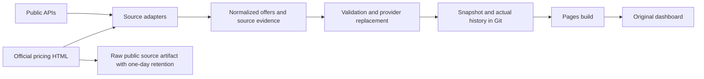

# Scheduled provider ingestion

## 1. Objective and constraints

Collect current, first-party GPU prices for the existing dashboard using GitHub
Actions and Pages. Preserve the original UI, existing RunPod observations, and
seven-day history. No paid server, GPU allocation, account creation, or private
credential discovery. Connected public sources now include RunPod, CoreWeave, Paperspace, Hyperstack, Verda, Crusoe, Vultr and Nebius;
Lambda remains authenticated because its public table currently advertises rates
that take effect November 16, 2026, rather than current prices. TensorDock's
unauthenticated locations request returned an empty list; it does not qualify
price coverage. Fluidstack has no verified current public catalog.

## 2. Current-system model

Provider adapters return normalized offers. The collector validates them,
replaces successful provider catalogs, retains failed providers' previous
observations, appends actual history, and atomically writes `latest.json`.
A single serialized workflow persists the JSON to Git, builds the React
frontend, and publishes only `dist`. The browser never handles provider secrets.

## 3. Evidence and ranked bottlenecks

1. Coverage baseline before the public-source extension: only RunPod was observed. Official CoreWeave HTML and
   Paperspace pricing tables were fetched successfully on November 5, 2026.
2. Semantic fidelity: the old schema calls every source an API and cannot express
   a published rate without implying the same evidence as a stock API.
3. Parsing ambiguity: CoreWeave contains separate region tables, mobile copies,
   spot rates, and inference rates. Paperspace's two multi-GPU rows conflict with
   its explicit single-price-times-GPU-count rule. These must not become offers.
4. Access: Lambda and TensorDock credentials are absent. Counts and fixture tests
   cannot establish their authenticated integration.

## 4. Competing designs

| Design                                | Benefit                                          | Limitation                                                    |
| ------------------------------------- | ------------------------------------------------ | ------------------------------------------------------------- |
| Keep API-only pipeline                | Smallest system                                  | Leaves publicly available rates uncollected                   |
| Extend adapters and evidence contract | Reuses publication/recovery; adds usable sources | HTML structure requires regression fixtures and failure gates |
| Always-on crawler/database/API        | Interactive collection and richer storage        | Hosting and operational work exceed this task's needs         |

Choose the adapter extension. Do not introduce a scheduler, database, or second
publication path.

## 5. Chosen architecture and rationale

The source adapter owns extraction and units. The collector owns validation,
provider state, historical persistence, and atomic local publication. GitHub
Actions owns execution serialization and deployment. UI helpers own freshness
and display, never price inference.

## 6. Component and interface contracts

- `Source.fetch(at)` returns offers, optional public source evidence, and explicit
  exclusions. Provider exceptions never become public messages or artifacts.
- An offer has USD per GPU-hour, full node price, GPU count, observed time, source
  URL, and source kind (`api` or `pricing_page`). New pricing-page observations
  require the raw price, its per-instance/per-GPU basis, and the content SHA-256.
- Published pricing-page offers always have `unknown` availability. Fetching a
  public page establishes that its rate was observed, not rentable capacity or
  the time the provider last changed its price.
- CoreWeave publishes on-demand node rates: divide by the listed GPU count once.
  Preserve region and configuration in identity. Ignore mobile duplicates, spot,
  inference-only rates, CPU products, and contact-sales rows.
- Paperspace single-machine rates are direct node rates. Multi-GPU rows must
  agree with the page's explicit multiplication rule; conflicts are recorded as
  exclusions. No machine specs or physical variants are guessed from generic
  type names. An ambiguous combined V100 label is excluded.
- Schema version 1 remains readable: new API metadata fields are optional for
  preserved observations. Pricing-page fields are required conditionally.
  Existing history is retained and new history points carry source metadata.

## 7. Runtime dynamics

Collection is scheduled every 15 minutes, with push and manual triggers. Source HTTP requests have finite
timeouts and size limits, with no browser execution or automatic parser repair.
Only public HTML and unauthenticated public API payloads are archived as a workflow artifact; authenticated responses are
not archived. Git persistence precedes Pages deployment. Browser revalidation
continues every minute; it does not launch ingestion.

## 8. Failure modes and mitigations

- Changed headers/regions/row structure, unexpected prices, empty HTML extraction,
  or duplicate identities fail the source and preserve its prior timestamps.
- Explicit quote-required and contradictory rows are excluded with stable reason
  codes rather than guessed prices. Supported non-conflicting rows remain usable.
- Source evidence accompanies the accepted catalog; failed attempts do not replace
  evidence for retained prices. Stale or failed sources do not feed current floors.
- Future-effective published rates are not current offers. Missing credentials
  remain `not_configured`; absent collectors remain `not_connected`.
- Concurrent Git writes can stop a run; no force push is used. A failed deployment
  leaves collected observations in Git and the last deployed site available.

## 9. Verification and promotion gates

Before publication: existing RunPod/recovery tests pass, recorded-source fixtures
produce independent expected prices and counts, mutations reject header/region/
unit drift, contact-sales/mobile/spot/inference/CPU rows never leak into offers,
Paperspace conflicts stay excluded, and new metadata survives collection/history.
The initial qualification on November 5 passed 31 tests, and a fresh collection produced
69 RunPod, 18 CoreWeave, and 15 Paperspace offers. CoreWeave exclusions: six
contact-sales rows. Paperspace exclusions: one ambiguous model and two conflicting
multi-GPU prices. Captured original response hashes and URLs are in
`scripts/fixtures/retrieval-receipts.json`; the HTML fixtures contain factual table
excerpts. A fixture regression reproduced and prevented the omitted-H100 selector
failure. Model tests prevent GB200/GH200 from aliasing B200/H200.

Then fetch fresh official pages, verify representative raw-to-normalized values,
run type checking and the Pages build, and inspect the preserved UI. Finally
require a successful GitHub workflow and a public snapshot with matching provider
counts and source hashes. Live HTTP proves retrieval; fixtures prove controlled
semantics; neither proves authenticated integration or guaranteed capacity.

## 10. Migration and execution plan

Add the evidence contract and public adapters first; retain existing identities
and RunPod behavior. Save minimal factual HTML fixtures and retrieval receipts.
Run adversarial tests, live collection, build, and UI checks. Deploy through the
existing workflow and verify the public artifact. Rollback is the previous source
commit and its snapshot; do not erase Git history. The next independent boundary
is authenticated Lambda/TensorDock qualification after credentials are supplied.

## Authoritative references

- https://www.coreweave.com/pricing
- https://docs.digitalocean.com/products/paperspace/pricing/
- https://docs.lambda.ai/public-cloud/cloud-api/
- https://lambda.com/instances
- https://dashboard.tensordock.com/api/docs/fetch-hostnodes
- https://fluidstack.io/
- HGX H100/H200 variant normalization:
  https://docs.nvidia.com/enterprise-reference-architectures/hgx-ai-factory-h100-h200-b200/latest/components.html

## Movement extension — November 5, 2026

The measured objective is broader qualified coverage plus visible real price and
listing-pool changes, preserving the existing interface and free deployment.
Animating invented price fluctuations was rejected. A database/live-server rewrite
adds no necessary signal; the existing collector owns the required state.

Adapters now return optional historical price points. Nebius imports public
`METHOD_LAST_PRICE` / `GRANULARITY_HOUR_1` series for the preceding seven days.
The unfinished current-hour bucket is excluded. These are interval-end provider summaries, labeled `provider_hourly_last`;
collector observations use `collector`. USD/GPU-hour, source identity, current SKU
membership, nonfuture timestamps, positive prices, and complete pagination are
validated before any provider state changes. Source errors retain old data.
`billingModel=spot` is excluded from on-demand floors and comparisons. Historical
import failure fails the whole Nebius refresh; it cannot silently truncate history.

`configurationKnown=false` marks a quoted per-GPU rate whose node configuration
is not established. GPU count and total remain a one-GPU normalization internally;
the UI and CSV explicitly suppress any claim that this is an actual node price.
HTML provenance rules remain unchanged. Vultr node prices/VRAM are divided once.
Crusoe's reviewed current column is valid only before December 1, 2026; its adapter
fails closed at that transition. Hyperstack maximum CPU/RAM are not allocations.

The collector alone owns `poolHistory`. Each successful provider snapshot records
observed-listing counts by availability and changes relative to its last success:
added IDs, removed IDs, changed prices and changed reported availability. A first
observation is a zero-delta baseline. Older snapshots can migrate from their
actual last-success timestamp and retained offers. Failed refreshes create no
pool observation or removal. Counts are not fleet GPU counts. Seven days persist.

The frontend replays discrete verified timestamps with a fixed elapsed-time axis,
manual playback and scrubbing; no interpolation fabricates observations. Price
lines keep gaps. Pool lines use step transitions. Motion is user initiated and
price transitions respect reduced-motion preferences. Both panels return to latest.

Promotion gates: factual source fixtures, invalid header/unit/page/future-date
mutations, pool baseline/removal/change/failure tests, existing recovery tests,
type checking, production build, live collection, browser interaction, successful
Actions deployment and public snapshot verification. No authenticated provider
integration or physical capacity guarantee follows from these checks.

Additional primary source references:
- https://www.hyperstack.cloud/gpu-pricing
- https://verda.com/pricing
- https://www.crusoe.ai/cloud/pricing
- https://api.vultr.com/v2/plans?per_page=500
- https://docs.nebius.com/signup-billing/spot-prices
- https://api.nebius.cloud/billing/v1alpha1/spot-price

Browser refresh uses an observable catalog revision so every mounted dashboard reads the validated snapshot after a successful request. Manual, periodic and focus refreshes share one in-flight request. The browser uses a cache-busting query, no-store caching and a 20-second timeout. Schema-invalid, failed or older snapshots retain the last validated data and expose refresh failure. Checks update in place and preserve local tab/filter state; last checked time is distinct from source observation time.

Availability and pool presentation extension: current inventory selectors live in
`shared/offer-view.ts` and apply the same freshness contract as offer badges.
Historical pool totals are not re-filtered using today's listings, since doing
so would misrepresent past membership; the timeline explicitly retains provider
scope. Billing and cloud security tier are displayed separately. Prime's adapter
requests single-GPU configurations, validates USD prices, maps explicit stock,
and requires complete stable pagination. The optional PRIME_API_KEY is passed
only to the collector. Unknown stock and missing credentials never become green
availability. Multi-GPU and spot Prime pricing remain unqualified. Local banner
assets replace remote placeholders; generated art is decorative.

Market presentation uses pure quote/history/stat selectors in shared/market.ts.
H100 floors require freshness and separate billing; limited/unknown capacity does
not disappear from aggregation. Chart samples are isolated by exact offer ID,
sorted by actual time and bounded by selected range. Sampled high/low are not
intraperiod market extrema; no OHLC or trading volume is inferred. Removed listing
history remains selectable while retained. The backend retention and collection
cadence are unchanged. Offer availability never disables source/provider links.
