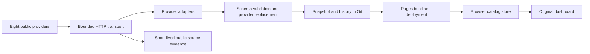

# GPU Price Observatory architecture

## 1. Objective and constraints

Aggregate first-party GPU prices and observed availability on a free GitHub Pages site. Preserve the original desktop dashboard, real timestamps, listing identity and seven-day history. Collection is scheduled, not an always-on backend. No SaaS account system, paid compute, database or private provider credentials are needed.

## 2. Current-system model

The collector owns writes. The workflow serializes publication. The browser is a read-only consumer apart from local price-alert storage. A snapshot is installed as a whole after validation; consumers subscribe to a revision rather than fetching independently.

## 3. Evidence and ranked bottlenecks

The cleanup baseline contained eight working public providers, four disconnected adapters, unused generated UI/theme scaffolding, duplicated HTTP readers and dependency advisories. Alert storage trusted arbitrary parsed JSON; CSV escaping covered formula prefixes only in the first character. These paths have explicit regression coverage after cleanup.

Remaining operational constraints are provider HTML drift, delayed GitHub schedules, seven-day storage growth, and stock information that most price catalogs do not supply. A successful fetch cannot establish rentable capacity. Recharts 2 is retained for chart compatibility; its dependency graph is audited, but migration to its maintained major is separate work.

## 4. Competing hypotheses and designs

| Design                                          | Evidence and tradeoff                                                                  | Decision                                      |
| ----------------------------------------------- | -------------------------------------------------------------------------------------- | --------------------------------------------- |
| Keep dormant adapters and generated wrappers    | Adds secret/configuration paths without current data or UI behavior                    | Remove unused implementations and assets.     |
| Consolidate transport and provider presentation | Three real transport callers and three offer-display callers repeat the same contracts | Use one implementation at each existing seam. |
| Add a hosted backend or replace the UI stack    | Does not resolve missing provider stock contracts; adds hosting and migration cost     | Outside the free Pages objective.             |

## 5. Chosen architecture and rationale

The collector and browser store remain deep modules with small interfaces. Source adapters vary behind the `Source.fetch(at)` seam; normalized results hide extraction details from publication. The HTTP module provides bounded reads behind one interface for all public provider adapters. ProviderIdentity concentrates logo, billing, cloud tier and source display so one fix benefits offer rows, pool cards and comparison headers.

Depth is judged by behavior exercised through the interface, not file size. These shared implementations provide leverage for callers and locality for maintenance. Pass-through theme, toast, tooltip and class-name wrappers were removed because they had no active callers requiring that behavior.

## 6. Module and interface contracts

| Module                | Interface and owner                      | Invariants and failure behavior                                                                                                                                                                                   |
| --------------------- | ---------------------------------------- | ----------------------------------------------------------------------------------------------------------------------------------------------------------------------------------------------------------------- |
| Public transport      | `fetchPublicText(url, accept, options)`  | Fixed provider URLs; 20-second timeout; 2 MB advertised/streamed limit; expected content type and valid UTF-8. Fail before parsing on violation.                                                                  |
| Provider adapters     | `Source.fetch(at)`                       | Return exact listing identity, normalized USD/GPU-hour, optional known node configuration, source evidence, exclusions and provider hourly history. Do not infer stock from price.                                |
| Schema                | `snapshotSchema`, `offerSchema`          | Finite positive prices; node/per-GPU agreement; unique IDs; no future observations/history; pricing-page provenance must match source evidence.                                                                   |
| Collector             | `collect(previous, adapters, at)`        | Validate before replacing provider data. Retain failed providers' prices/timestamps; append no failed samples. Success replaces all listings, even with an empty result. Invalid previous state fails explicitly. |
| Browser catalog       | `loadCatalog`, subscription and revision | One in-flight request for timer/focus/manual refresh. Validate before install, reject backwards snapshots, retain loaded data on error, report refresh state.                                                     |
| Market/filter helpers | Pure snapshot queries                    | Preserve exact offer identity, physical variant and billing type. Stale/failed sources do not establish a current floor or fresh stock.                                                                           |
| Price alerts          | `usePriceAlerts`                         | Validate each stored entry and new target; no inherited-key lookups; persist before reporting save success; keep earlier state if storage fails.                                                                  |
| CSV                   | `toCSV(rows)`                            | Quote every cell; escape quotes; neutralize formula/control prefixes including hidden leading whitespace.                                                                                                         |
| Provider display      | `ProviderIdentity({offer})`              | Local official provider asset, billing distinct from cloud tier, linked evidence. No invented availability.                                                                                                       |

RunPod provides a per-GPU catalog rate and a separate one-GPU stock report; neither asserts a full rentable node configuration. CoreWeave and Vultr node prices are divided once. Pricing-page observations require raw price, basis, retrieval timestamp, source URL and content hash. Nebius hourly history stays labeled `provider_hourly_last`, separate from collector observations. Unsupported pagination, ambiguous models, contradictory rates and effective-date transitions fail closed or produce explicit row exclusions.

## 7. Runtime dynamics

The Actions workflow runs on main pushes, manual dispatch and quarter-hour schedules. Its concurrency group serializes refresh/deploy runs. Build has contents-write permission solely to preserve the snapshot; deploy separately receives Pages/OIDC permissions. No provider secrets are configured or referenced.

The collector retains a rolling seven-day window and deduplicates history by offer ID and observation timestamp. It writes a temporary snapshot then renames it locally. Git commit/push and Pages deployment are subsequent operations, not part of that local atomic write. A failed push/build/deploy fails its workflow step; local success does not prove remote publication.

The browser polls every minute and on visibility/focus return, preserving mounted tabs and filters. A failed refresh keeps visible data with an error status. Selection stores IDs and reconciles them against current listings. Dialogs portal to the body, trap focus, restore focus/scroll and cancel pending dismissal timers on unmount.

## 8. Failure modes and mitigations

- Provider/network/schema failure: retain last verified observations with failed source status; overview excludes them and Offers can inspect them.
- Missing stock: show a stock-check action, preserving limited/available/unavailable only when explicitly reported.
- No history or unchanged prices: display sample count/interval and collecting/unchanged state; never synthetic movement.
- Malformed or inaccessible alert storage: isolate invalid entries and show unsuccessful writes; browsing remains usable.
- Spreadsheet formula injection: neutralize untrusted exported string prefixes before quoting.
- Oversized/truncated/non-UTF-8 provider input: bounded transport fails and cancels oversized streams.
- Dependency advisories: use a committed frozen lockfile and `pnpm audit:deps`; a clean audit is a time-specific advisory result, not proof of no vulnerabilities.
- Official HTML changes or Crusoe's effective-date transition: fixtures and explicit parser assertions expose drift; real collection remains a required release check.

## 9. Verification and promotion gates

Run `pnpm check`, `pnpm test`, `pnpm audit:deps` and `pnpm build:pages`. Type checks reject unused locals and parameters. Tests exercise parser provenance/units, invalid data, replacement/removal, retained failure timestamps, history identity, billing separation, freshness, browser refresh serialization, comparison selection, dialog lifecycle, local storage, CSV and HTTP limits.

Before publication, collect against all active providers and inspect statuses and retained history. Verify official logos and provider labels, comparison, alerts, filters and charts in the production build. Promotion requires both Actions jobs to succeed and the published snapshot/assets to match the deployed build. Do not equate fixtures or local tests with provider integration or a successful live deployment.

## 10. Migration and execution plan

Snapshot schema remains version 1; optional fields and existing historical identities remain compatible. Disconnected Prime Intellect/Lambda/TensorDock/Fluidstack implementations and their unused logos/secret configuration are removed. Existing committed data and fixtures are preserved; successful collection now publishes only the eight active source statuses while retaining earlier history within the rolling window.

Deploy through the existing workflow after local gates. Rollback uses a reviewed revert of application/config changes while preserving newer observations; never reset the data history to roll back the UI. Future provider additions must establish first-party units, effective dates, availability semantics and complete pagination before joining the source registry.
